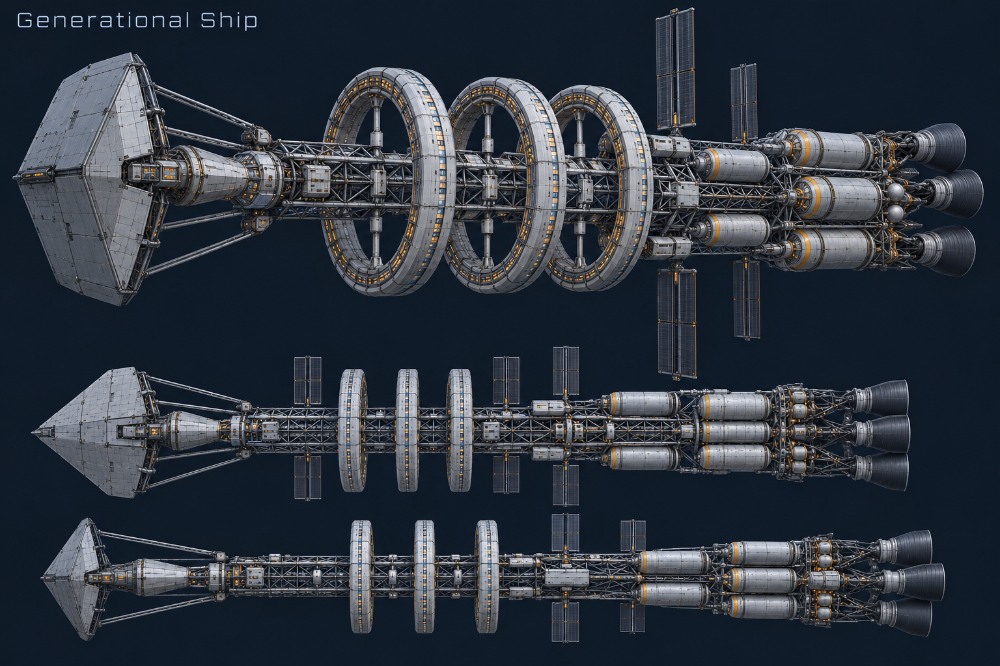
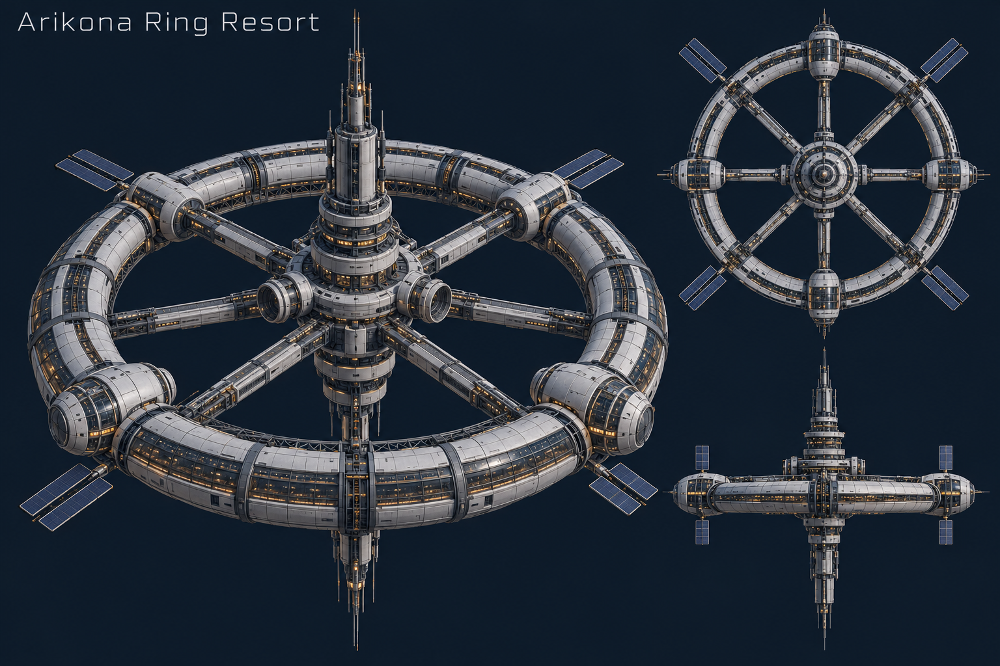
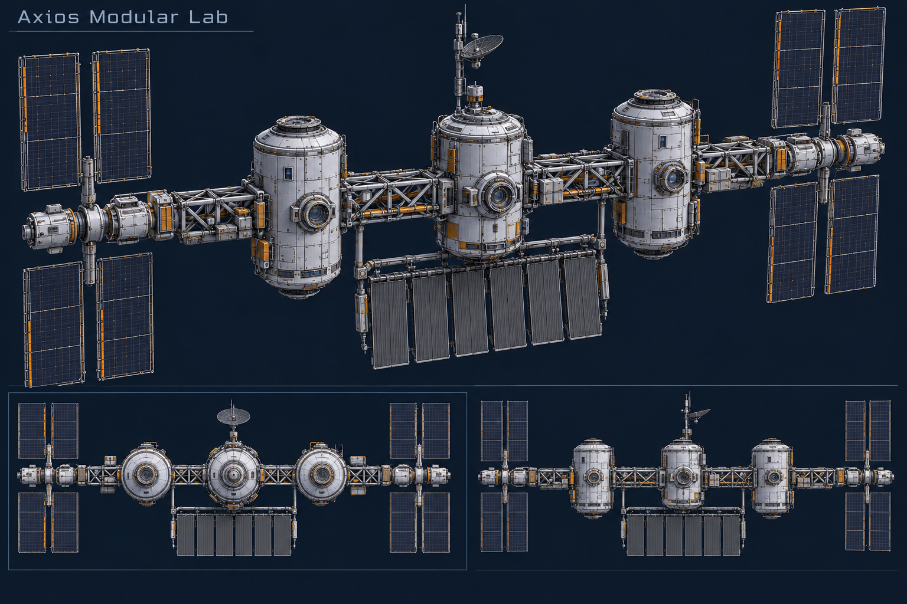
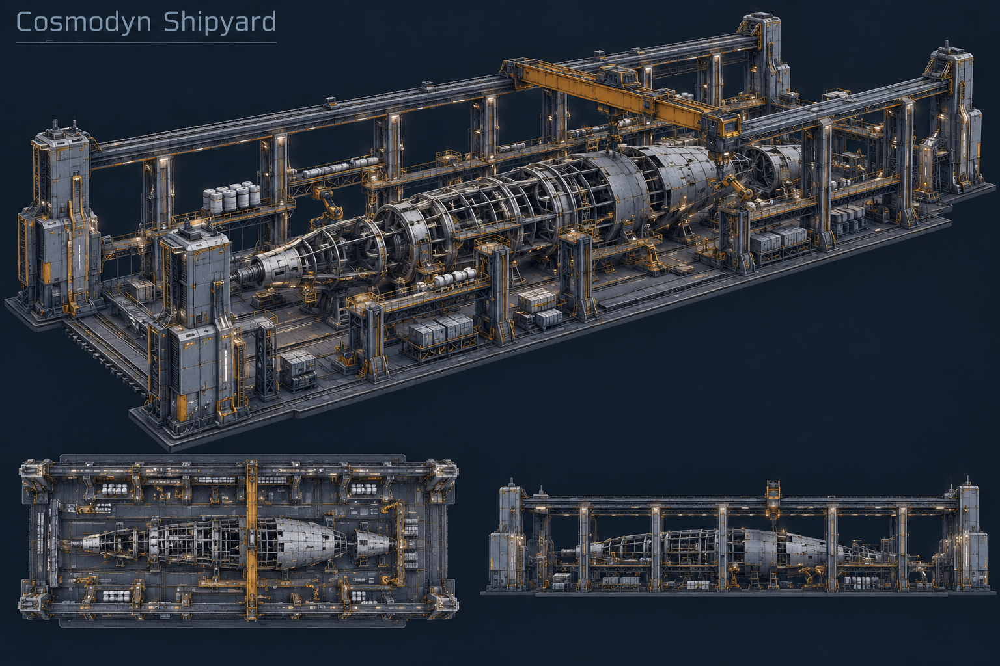
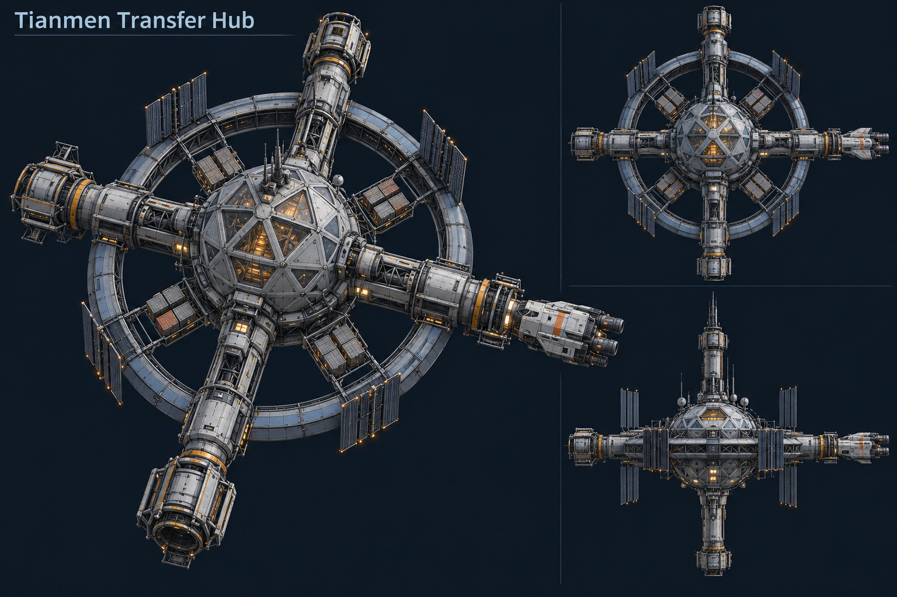
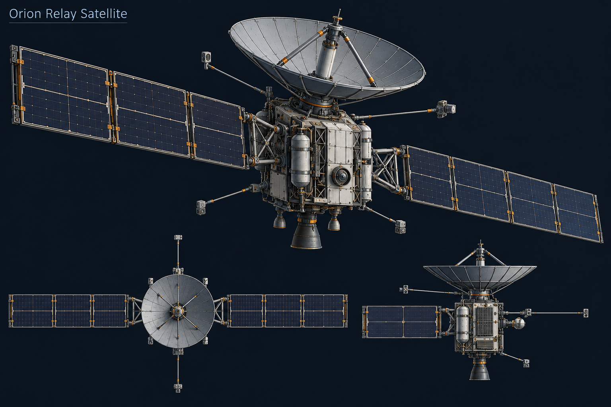
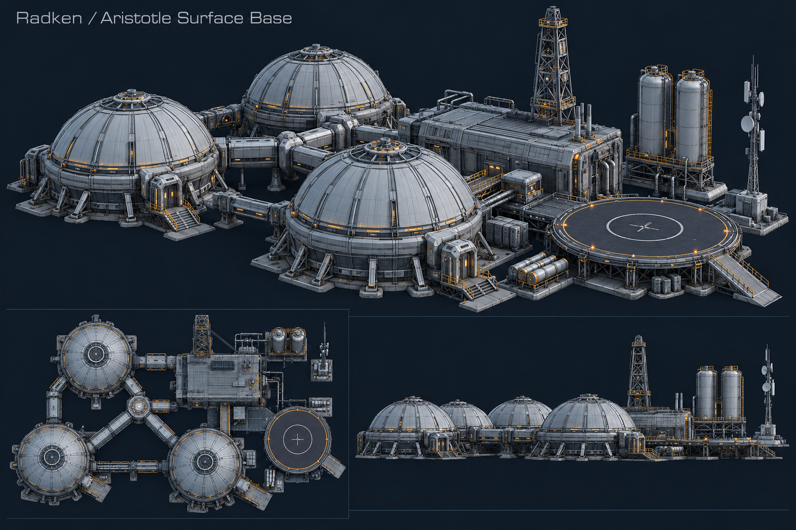

# Hard-sci-fi concept references

Generated with the built-in imagegen tool before geometry implementation. These are modeling references only and are not shipped in the application bundle. Original designs use The Expanse and Avatar as functional industrial design influences. Geometry deliberately simplifies fine surface detail for holographic readability.

## Generational Ship

Prompt:

Use case: stylized-concept. Asset type: production reference sheet for a procedural Three.js hard-science-fiction model. Original engineered design inspired by The Expanse spacecraft functionality and Avatar industrial machinery, not a replica. Wide dark navy technical sheet, large three-quarter view plus smaller top and side structural views of the SAME consistent object. Restrained icy blue edge lines on readable matte steel solid forms; occasional muted amber engineering accents. Functional exposed structure, pressure vessels, docking access, thermal management. Strong clear silhouette and moderate detail that can be built with cylinders, torus segments, boxes, cones and line segments. No tiny clutter, no ornate fantasy shapes, no background scene, no logos. Label only with the asset title. Title: Generational Ship. Subject: Long open lattice spine along X, three rotating habitat rings around X amidships, clustered propellant tanks aft, four large engine bells at rear, broad forward debris shield and tapered bow. Add segmented habitats, radiator wings, engine supports and shield stand-offs.

## Arikona Ring Resort

Prompt:

Use case: stylized-concept. Asset type: production reference sheet for a procedural Three.js hard-science-fiction model. Original engineered design inspired by The Expanse spacecraft functionality and Avatar industrial machinery, not a replica. Wide dark navy technical sheet, large three-quarter view plus smaller top and side structural views of the SAME consistent object. Restrained icy blue edge lines on readable matte steel solid forms; occasional muted amber engineering accents. Functional exposed structure, pressure vessels, docking access, thermal management. Strong clear silhouette and moderate detail that can be built with cylinders, torus segments, boxes, cones and line segments. No tiny clutter, no ornate fantasy shapes, no background scene, no logos. Label only with the asset title. Title: Arikona Ring Resort. Subject: Single horizontal spin-gravity torus with eight reinforced spokes, central vertical service hub and spire, docking collars on the hub, observation bands, four habitat pods and small solar wings. Add segmented ring accommodation and service access.

## Axios Modular Lab

Prompt:

Use case: stylized-concept. Asset type: production reference sheet for a procedural Three.js hard-science-fiction model. Original engineered design inspired by The Expanse spacecraft functionality and Avatar industrial machinery, not a replica. Wide dark navy technical sheet, large three-quarter view plus smaller top and side structural views of the SAME consistent object. Restrained icy blue edge lines on readable matte steel solid forms; occasional muted amber engineering accents. Functional exposed structure, pressure vessels, docking access, thermal management. Strong clear silhouette and moderate detail that can be built with cylinders, torus segments, boxes, cones and line segments. No tiny clutter, no ornate fantasy shapes, no background scene, no logos. Label only with the asset title. Title: Axios Modular Lab. Subject: An open horizontal truss with three pressure modules mounted perpendicular to it, paired rectangular solar wings at both ends, radiator below and antenna mast. Add module seams, airlocks, instrument pallets, articulated panel hinges.

## Cosmodyn Shipyard

Prompt:

Use case: stylized-concept. Asset type: production reference sheet for a procedural Three.js hard-science-fiction model. Original engineered design inspired by The Expanse spacecraft functionality and Avatar industrial machinery, not a replica. Wide dark navy technical sheet, large three-quarter view plus smaller top and side structural views of the SAME consistent object. Restrained icy blue edge lines on readable matte steel solid forms; occasional muted amber engineering accents. Functional exposed structure, pressure vessels, docking access, thermal management. Strong clear silhouette and moderate detail that can be built with cylinders, torus segments, boxes, cones and line segments. No tiny clutter, no ornate fantasy shapes, no background scene, no logos. Label only with the asset title. Title: Cosmodyn Shipyard. Subject: Rectangular open drydock with four long corner rails and six braced bays surrounding a partly built tapered spacecraft rib hull, overhead gantry crane. Add manipulators, cargo racks, service decks and sparse partial hull plating; preserve open negative space.

## Tianmen Transfer Hub

Prompt:

Use case: stylized-concept. Asset type: production reference sheet for a procedural Three.js hard-science-fiction model. Original engineered design inspired by The Expanse spacecraft functionality and Avatar industrial machinery, not a replica. Wide dark navy technical sheet, large three-quarter view plus smaller top and side structural views of the SAME consistent object. Restrained icy blue edge lines on readable matte steel solid forms; occasional muted amber engineering accents. Functional exposed structure, pressure vessels, docking access, thermal management. Strong clear silhouette and moderate detail that can be built with cylinders, torus segments, boxes, cones and line segments. No tiny clutter, no ornate fantasy shapes, no background scene, no logos. Label only with the asset title. Title: Tianmen Transfer Hub. Subject: Central geodesic node, four radial docking tunnels in a cross, navigation ring and small shuttle docked at right. Add docking vestibules, collar latches, cargo pallets, radiators and practical shuttle engine hardware.

## Orion Relay Satellite

Prompt:

Use case: stylized-concept. Asset type: production reference sheet for a procedural Three.js hard-science-fiction model. Original engineered design inspired by The Expanse spacecraft functionality and Avatar industrial machinery, not a replica. Wide dark navy technical sheet, large three-quarter view plus smaller top and side structural views of the SAME consistent object. Restrained icy blue edge lines on readable matte steel solid forms; occasional muted amber engineering accents. Functional exposed structure, pressure vessels, docking access, thermal management. Strong clear silhouette and moderate detail that can be built with cylinders, torus segments, boxes, cones and line segments. No tiny clutter, no ornate fantasy shapes, no background scene, no logos. Label only with the asset title. Title: Orion Relay Satellite. Subject: Compact cuboid instrument bus, upward parabolic dish with support and feed struts, two long opposed rectangular solar wings, small downward propulsion unit. Add dish ribs, array hinges, sensor booms and attitude thrusters.

## Radken / Aristotle Surface Base

Prompt:

Use case: stylized-concept. Asset type: production reference sheet for a procedural Three.js hard-science-fiction model. Original engineered design inspired by The Expanse spacecraft functionality and Avatar industrial machinery, not a replica. Wide dark navy technical sheet, large three-quarter view plus smaller top and side structural views of the SAME consistent object. Restrained icy blue edge lines on readable matte steel solid forms; occasional muted amber engineering accents. Functional exposed structure, pressure vessels, docking access, thermal management. Strong clear silhouette and moderate detail that can be built with cylinders, torus segments, boxes, cones and line segments. No tiny clutter, no ornate fantasy shapes, no background scene, no logos. Label only with the asset title. Title: Radken / Aristotle Surface Base. Subject: Three hemispherical pressure domes connected by corridors, rectangular processing shed, tall open lattice derrick, paired silos, circular landing pad and comms mast. Add foundations, ribbed domes, airlocks, corridor supports, storage pipes and pad access.

